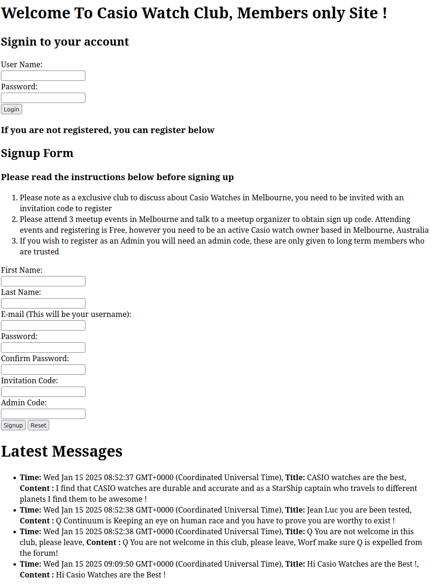
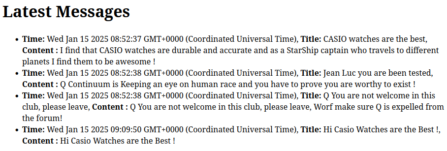
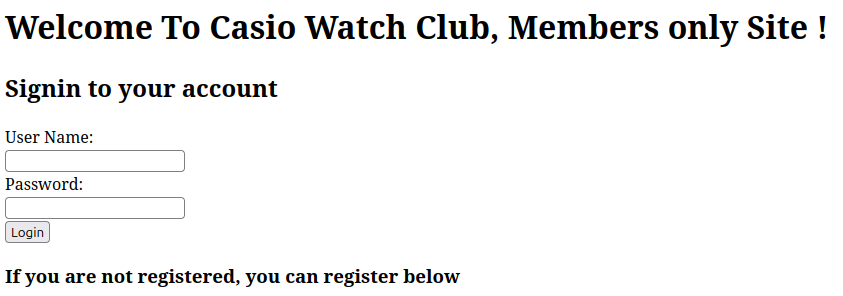
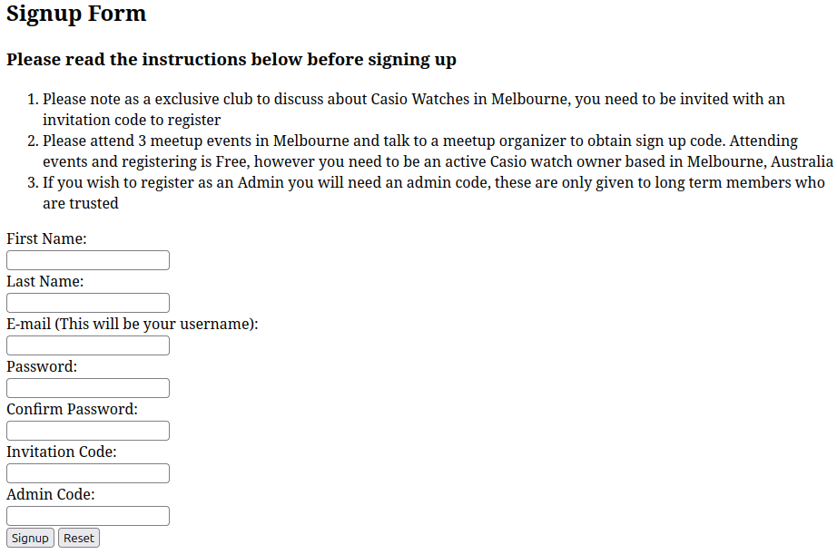
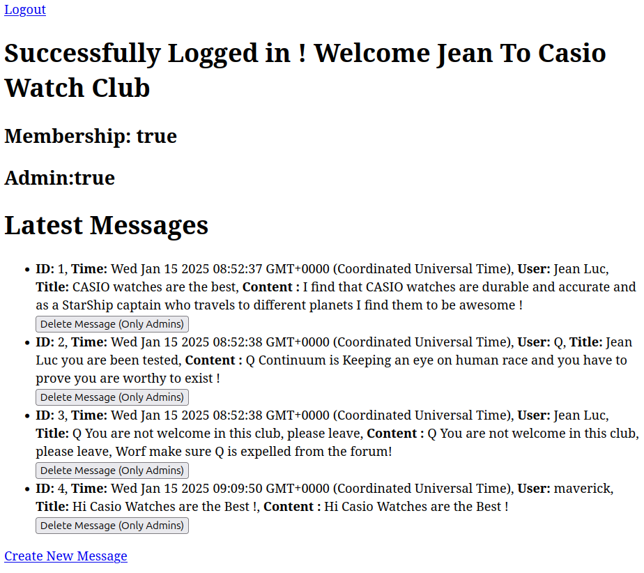
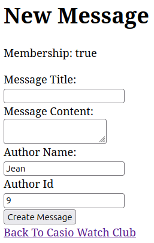

# Members Only

A membership-based message board where users can publish messages, with author identities visible only to authenticated users.

## Table of Contents

- [Overview](#overview)

- [Features](#features)

- [Screenshots](#screenshots)

- [Tech Stack](#tech-stack)

- [Architecture](#architecture)

- [Getting Started](#getting-started)
  - [Prerequisites](#prerequisites)

  - [Installation](#installation)

  - [Environment Variables](#environment-variables)

- [Project Structure](#project-structure)

- [Available Scripts](#available-scripts)

- [Development](#development)

- [Testing](#testing)

- [Database Design](#database-design)

- [Deployment](#deployment)

- [Troubleshooting](#troubleshooting)

- [Contributing](#contributing)

- [License](#license)

- [Acknowledgements](#acknowledgements)

- [Contact](#contact)

---

## Overview

**Members Only** is a membership-based message board built with Node.js, Express.js and PostgreSQL.

The application allows visitors to browse messages without seeing their authors' identities. Registered users can authenticate, gain membership through an invitation code and publish messages.

Authenticated members can see additional information about message authors, while administrators have additional privileges, including message deletion.

The project demonstrates server-side rendering, authentication, role-based access, database integration and form validation in a traditional Express application.

## Features

- **User Registration**
  - Register with a first name, last name, email address and password.

  - Validate registration details using Express Validator.

  - Hash passwords using bcryptjs before storing them.

- **Authentication**
  - Authenticate users using Passport.js Local Strategy.

  - Maintain authenticated sessions using Express Session.

  - Serialize and deserialize users through Passport.

- **Membership System**
  - Upgrade an account to membership status using an invitation code.

  - Display additional message information to authenticated members.

- **Anonymous Message Board**
  - Allow visitors to browse messages without seeing author identities.

  - Display author information to authenticated users.

  - Display message titles, content and timestamps.

- **Message Management**
  - Allow authenticated users to create messages.

  - Provide message deletion functionality for administrative use.

- **Administrative Privileges**
  - Support administrator accounts through a separate administrative code.

  - Provide additional administrative privileges, including message deletion.

- **Server-Side Rendering**
  - Render application pages using EJS templates.

  - Provide different views depending on authentication status.

- **Input Validation**
  - Validate registration, login and message submission forms.

  - Sanitize and escape submitted form values.

## Screenshots

### Main view





### Logged-in view



## Tech Stack

| Category                  | Technology            |
| ------------------------- | --------------------- |
| Runtime                   | Node.js               |
| Backend                   | Express.js 4          |
| Language                  | JavaScript (CommonJS) |
| Templating Engine         | EJS                   |
| Authentication            | Passport.js           |
| Authentication Strategy   | Passport Local        |
| Session Management        | Express Session       |
| Database                  | PostgreSQL            |
| Database Client           | node-postgres (`pg`)  |
| Password Hashing          | bcryptjs              |
| Input Validation          | Express Validator     |
| Environment Configuration | dotenv                |
| Package Manager           | pnpm (preferred)      |

### Dependencies

| Package             | Purpose                                |
| ------------------- | -------------------------------------- |
| `express`           | HTTP server and application routing    |
| `ejs`               | Server-side HTML rendering             |
| `pg`                | PostgreSQL database connectivity       |
| `passport`          | Authentication middleware              |
| `passport-local`    | Username and password authentication   |
| `express-session`   | Session management                     |
| `bcryptjs`          | Password hashing and verification      |
| `express-validator` | Form validation and input sanitization |
| `dotenv`            | Environment variable configuration     |

## Architecture

Members Only follows a traditional server-rendered MVC-style architecture using Express.js.

The application separates routing, request handling, database access, authentication and presentation into dedicated directories.

### Application Flow

1.  Visitors access the application through Express routes.

2.  Routes invoke the appropriate controller functions.

3.  Controllers validate incoming requests and coordinate application operations.

4.  Authentication is handled by Passport.js using its Local Strategy.

5.  Database operations are performed through PostgreSQL using the `pg` connection pool.

6.  EJS templates render the appropriate response based on the user's authentication status and privileges.

### Main Components

| Component      | Responsibility                                           |
| -------------- | -------------------------------------------------------- |
| `app.js`       | Application configuration, middleware and server startup |
| `routes/`      | Application route definitions                            |
| `controllers/` | Request handling and application logic                   |
| `db/`          | PostgreSQL connection and database queries               |
| `security/`    | Passport authentication configuration                    |
| `validators/`  | Registration, login and message validation               |
| `views/`       | EJS templates and rendered pages                         |

## Getting Started

### Prerequisites

Ensure the following tools and services are available:

- **Node.js:** A version compatible with the installed dependencies.

- **pnpm:** Preferred package manager.

- **PostgreSQL:** A running PostgreSQL database.

- **Git:** For cloning the repository.

### Installation

#### 1\. Clone the repository

```
git clone https://github.com/amalk-au/members-only.git

cd members-only
```

#### 2\. Install dependencies

The repository currently contains an npm lockfile rather than a pnpm lockfile.

To use pnpm, first import the existing dependency lockfile:

```
pnpm import
```

Then install dependencies:

```
pnpm install
```

Alternatively, use the existing npm lockfile:

```
npm ci
```

#### 3\. Configure environment variables

Create a `.env` file in the project root:

```
# Application
APP_PORT=3000

# PostgreSQL Database
DBHost=localhost
DBUser=your-db-user
DATABASE_NAME=members_only
DATABASE_PW=your-db-password
DATABASE_PORT=5432

# Membership and Administrative Codes
INVITATION_CODE=your-invitation-code
ADMIN_CODE=your-admin-code
```

Replace the example values with your actual configuration.

**Important:** The database connection currently enables SSL in `db/pool.js`. Ensure your PostgreSQL environment supports the configured SSL connection.

#### 4\. Configure the PostgreSQL database

Create a PostgreSQL database and configure the connection credentials in `.env`.

The application expects the following database tables:

- `users_table`

- `messages`

The database must contain the columns referenced by the application's SQL queries.

See [Database Design](#database-design) for the currently documented database structure.

No database migration or schema initialization command is currently provided in the repository.

#### 5\. Start the application

```
pnpm start
```

Alternatively:

```
npm start
```

The application defaults to port `3000` when `APP_PORT` is not configured.

Open the following address in your browser:

```
http://localhost:3000
```

## Environment Variables

The application reads its configuration through dotenv.

| Variable          | Description                                               | Required                            |
| ----------------- | --------------------------------------------------------- | ----------------------------------- |
| `APP_PORT`        | Port used by the Express application. Defaults to `3000`. | No                                  |
| `DBHost`          | PostgreSQL server hostname.                               | Yes                                 |
| `DBUser`          | PostgreSQL database username.                             | Yes                                 |
| `DATABASE_NAME`   | PostgreSQL database name.                                 | Yes                                 |
| `DATABASE_PW`     | PostgreSQL database password.                             | Yes                                 |
| `DATABASE_PORT`   | PostgreSQL server port.                                   | Yes                                 |
| `INVITATION_CODE` | Code used to obtain membership privileges.                | Yes for membership upgrades         |
| `ADMIN_CODE`      | Code used to obtain administrative privileges.            | Yes for administrative registration |

Never commit `.env` files, database credentials, invitation codes or other secrets to version control.

**Configuration note:** The current session configuration in `app.js` uses a hardcoded session secret. This should be replaced with an environment-based secret before production deployment.

## Project Structure

The repository is organised into the following main directories:

```
members-only/
├── controllers/
│   └── membersController.js
│
├── db/
│   ├── dbQueries.js
│   └── pool.js
│
├── routes/
│   └── appRouter.js
│
├── security/
│   └── passportConfig.js
│
├── validators/
│   ├── signupFormValidation.js
│   ├── signInFormValidation.js
│   └── newMessageFormValidation.js
│
├── views/
│   └── EJS templates
│
├── app.js
├── package.json
├── package-lock.json
├── .gitignore
├── LICENSE
└── README.md
```

### Directory Responsibilities

- `controllers/` — Handles application requests, authentication-related operations and message management.

- `db/` — Contains the PostgreSQL connection pool and SQL query functions.

- `routes/` — Defines the application's HTTP endpoints.

- `security/` — Configures Passport.js authentication and authentication middleware.

- `validators/` — Contains validation rules for user registration, login and message submission.

- `views/` — Contains EJS templates used for server-side rendering.

## Available Scripts

The available commands are defined in `package.json`.

| Command      | Description                                        |
| ------------ | -------------------------------------------------- |
| `pnpm start` | Start the Express application using `node app.js`. |
| `pnpm test`  | Currently unimplemented; exits with an error.      |

There are currently no configured build, lint, formatting or type-checking scripts.

## Development

The application uses CommonJS modules and a server-rendered Express architecture.

When making changes:

1.  Create a feature branch.

2.  Follow the existing directory structure and coding conventions.

3.  Keep database queries inside the `db/` directory.

4.  Keep request-handling logic inside the appropriate controller.

5.  Define application endpoints in `routes/`.

6.  Add or update validation rules when introducing new form inputs.

7.  Test changes manually against a local PostgreSQL database.

8.  Open a pull request when your changes are ready.

Keep changes focused, maintainable and consistent with the existing architecture.

## Testing

Automated testing is not currently configured.

The existing `test` script in `package.json` is a placeholder that exits with an error.

For now, test application functionality manually.

Recommended areas to verify include:

- User registration and input validation.

- Password hashing and authentication.

- Login and logout functionality.

- Session persistence.

- Membership upgrades.

- Public and authenticated message visibility.

- Message creation.

- Administrative message deletion.

- Database connectivity and error handling.

A future improvement would be to introduce automated tests for controllers, routes, authentication and database operations.

## Database Design

The application uses PostgreSQL for persistent user and message storage.

Two primary tables are referenced by the application's SQL queries.

### 1\. Users Table

The `users_table` stores account information and user privileges.

| Column              | Description                                               |
| ------------------- | --------------------------------------------------------- |
| `id`                | User identifier and primary key.                          |
| `first_name`        | User's first name.                                        |
| `last_name`         | User's last name.                                         |
| `username`          | User's email address and login identifier.                |
| `password`          | Hashed user password.                                     |
| `membership_status` | Indicates whether the user has membership privileges.     |
| `admin`             | Indicates whether the user has administrative privileges. |

### 2\. Messages Table

The `messages` table stores messages submitted by users.

| Column      | Description                             |
| ----------- | --------------------------------------- |
| `id`        | Message identifier.                     |
| `title`     | Message title.                          |
| `content`   | Message content.                        |
| `timestamp` | Message creation timestamp.             |
| `author_id` | References the author in `users_table`. |

**Note:** This documentation describes the columns referenced by the application and the original README. The repository does not currently contain a database migration or schema initialization file.

## Deployment

The application is a Node.js and Express server that requires a PostgreSQL database.

A production deployment requires:

1.  A hosting environment capable of running Node.js applications.

2.  A PostgreSQL database accessible from the application.

3.  Correct production environment variables.

4.  A valid database SSL configuration.

5.  A secure session secret.

6.  A configured application port.

## Troubleshooting

| Issue                                     | Possible Solution                                                       |
| ----------------------------------------- | ----------------------------------------------------------------------- |
| Application fails to start                | Check the installed Node.js version and dependency installation.        |
| Database connection fails                 | Verify PostgreSQL availability, credentials, hostname and port.         |
| SSL connection errors                     | Check the database SSL configuration in `db/pool.js`.                   |
| Authentication fails                      | Verify the username, password and Passport configuration.               |
| Membership upgrade fails                  | Check that `INVITATION_CODE` matches the submitted code.                |
| Administrative privileges are unavailable | Verify the `ADMIN_CODE` configuration.                                  |
| Application returns a server error        | Check the terminal output and application logs.                         |
| Dependencies fail to install with pnpm    | Import the existing npm lockfile using `pnpm import` before installing. |

## Contributing

Contributions and suggestions are welcome.

To contribute:

1.  Fork the repository.

2.  Create a feature branch.

3.  Implement your changes.

4.  Test the application locally.

5.  Submit a pull request describing your changes.

For significant changes, open an issue first to discuss the proposed implementation.

## License

This project includes a [GNU General Public License v3.0 (GPL-3.0)](LICENSE).

You are free to use, modify and distribute this software under the terms of the license.

See the [LICENSE](LICENSE) file for the complete license text.

## Acknowledgements

- [The Odin Project](https://www.theodinproject.com/) — Learning resources and project inspiration.

- [Node.js](https://nodejs.org/) — JavaScript runtime.

- [Express.js](https://expressjs.com/) — Web application framework.

- [Passport.js](https://www.passportjs.org/) — Authentication middleware.

- [PostgreSQL](https://www.postgresql.org/) — Relational database.

## Contact

- **Author:** Amal K.

- **Portfolio:** [amalk.au](https://amalk.au)

- **GitHub:** [@amalk-au](https://github.com/amalk-au)

- **Repository:** [Members Only](https://github.com/amalk-au/members-only)

- **Issues:** [GitHub Issues](https://github.com/amalk-au/members-only/issues)

---

Developed by [amalk-au](https://github.com/amalk-au)
